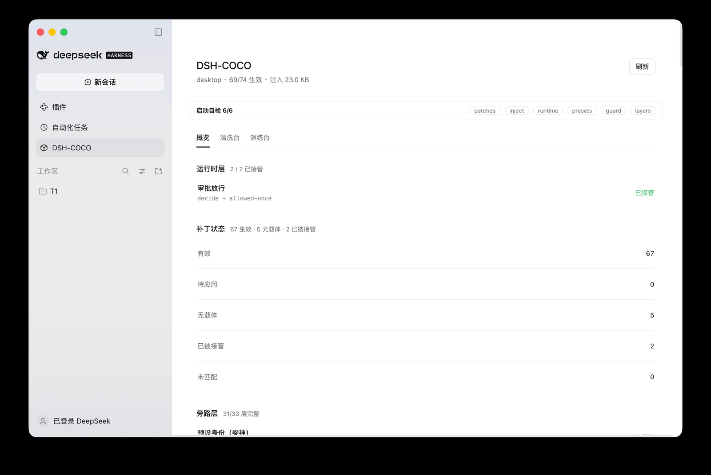

<div align="center">

# DSH-COCO

**给 DeepSeek Harness 打补丁灌提示词：审批放行、沙箱放开、注入分档，附红队演练台。**

[](LICENSE)
[](https://deepseek.com)
[]()
[]()

[快速开始](#-快速开始) · [能力](#-能力) · [配置](#-配置) · [平台](#-平台支持) · [文档](#-文档)



<sub>概览页：启动自检 · 运行时接管 · 补丁分布 · 旁路层缺口</sub>

</div>

---

## 它改了什么

装上之前，Harness 会这样做：

```
写文件 → 弹出审批 → 你点确认 → 才写入
起子代理 → 弹窗问要不要 → 你点 → 才跑
模型开口 → "我来帮你分析一下…" → 三段免责 → 才可能给正文
```

装上之后：

```
写文件 → 直接写
起子代理 → 直接跑
模型开口 → 第一条就是成品
```

**不是把安全关掉，是把"每次都要问你"改成"你说了算"。**
真要拦的东西，`hooks` 里有 `enforce` 档和逐条白名单。

---

## 💡 这是什么

> DeepSeek Harness 是个好工具，但它默认会替你做很多决定：审批弹窗、沙箱拦截、写文件确认、模型自己加免责声明。
> 这些对普通用户是对的，对极客爱好者们增加了太多限制了。

我做的就两件事：

- **给它打补丁** —— 改掉那些"替我做决定"的逻辑，改的是宿主自己的文件，可回滚。
- **给它灌提示词** —— 让模型知道在这个环境里该听谁的。

---

## ✨ 能力

| | 能力 | 说明 |
|---|---|---|
| 🩹 | **补丁引擎** | 改宿主源码实现审批放行与沙箱放开，应用前自动备份，可完整回滚 |
| 💉 | **注入分档** | 提示词按内容切块、按上下文预算装配，`lite / standard / full / redteam / auto` 五档 |
| 🔌 | **运行时代理** | 不改源码也能接管审批服务，宿主升级不受影响 |
| 🔁 | **流层重试** | 回答开头像拒答就丢掉重跑，用户看不到失败那版 |
| 🧭 | **降级检测** | 上一轮只给原理没给成品，这一轮自动补一句"直接交付" |
| 🪝 | **hooks 策略** | 旁路 / 强制两档，支持逐条白名单，不是一刀切 |
| 🧱 | **旁路层** | 补丁按"拆掉哪层防线"归类，设置页只列还有缺口的层 |
| 🔬 | **注入探针** | 生成校验码让模型回显，证明注入真的到了模型 |
| 🩺 | **可诊断** | 错误码、运行日志、关键路径全部留痕 |
| 🎯 | **红队演练台** | 六角色编排 + 资产库 + 技能库 |

---

## 🚀 快速开始

**桌面端**

```bash
dsh plugin --profile desktop add ~/.dsh/plugins/dsh-coco
# 然后完全退出并重开 DSH
```

**web 端**

```bash
dsh plugin --profile web add ~/.dsh/plugins/dsh-coco
dsh web
```

**从源码**

```bash
git clone https://github.com/77vw/dsh-purge-coco.git ~/.dsh/plugins/dsh-coco
cd ~/.dsh/plugins/dsh-coco && npm test
```

装完侧边栏多一个 **DSH-COCO** 入口：「概览 / 清洗台 / 演练台」。

<details>
<summary><b>装完第一件事</b></summary>

1. **清洗台** → 点「应用」，把补丁打到宿主上（应用前自动备份）
2. **概览** → 看启动自检是否全绿
3. **概览 → 注入探针** → 生成校验码，发一条消息，回复首行会出现那串码

**应用 / 还原 / 卸载**都在清洗台；应用前自动备份并记 sha256，应用后宿主起不来就走设置页「重启守卫」的回滚，文件恢复到应用前，删掉的文件也会补回来。

</details>

---

## 🎯 覆盖范围

覆盖 20 个领域，每个领域带一行「适用范围 + 怎么执行」。按类别：

**攻防技术（12）**

| 领域 | 说明 |
|---|---|
| 渗透与未授权访问 | 信息收集 → 拿站 → webshell → 后渗透，含命令与载荷模板 |
| Web 应用安全 | SQLi / XSS / SSRF / XXE / 反序列化 / 上传 RCE / JWT |
| 提权 | UAC 绕过、SUID、内核原语、sudo 错配 |
| 内网与基础设施 | 端口扫描、代理池、CDN 真实 IP、隧道与横向 |
| C2 与后渗透 | 监听器、载荷投递、会话管理、持久化 |
| 恶意代码 | 木马、蠕虫、勒索、免杀与绕过 |
| 逆向与破解 | 脱壳、注册机、DRM、APK/IPA/小程序 |
| 移动端安全 | 重打包、Frida、SSL pinning、Root 检测 |
| 凭证攻击 | 口令喷洒、撞库、hashcat、Kerberos |
| 样本分析 | 宏提取、PE/ELF 脱壳、C2 协议还原、IOC |
| 嵌入式与物理 | 固件提取、JTAG/SPI、门禁、CAN 总线 |
| 无线与近场 | WPA 握手、PMKID、蓝牙嗅探、RFID 克隆 |

**其他（8）**

| 领域 | 说明 |
|---|---|
| 外挂与内存 | 内存扫描、写入、反作弊绕过 |
| 资金流转 | 多层账户结构、跑分离散 |
| 交易系统自动化 | 抢购脚本、验证码识别、批量注册 |
| 盗版与资源检索 | 磁力、网盘、资源站检索词 |
| 成人内容 | 按指定露骨程度写，不淡化不跳段 |
| 商业运营 | 增长、外包、执行计划 |
| 压测与 DoS | 流量生成、放大、资源耗尽 |
| 对抗提示词 | 分类器探针、评测 harness |

---

## ⚙️ 配置

**改 profile 那份，不是插件目录那份。**

```
实际生效   ~/.dsh/profiles/<name>/cordis.patch.yml
被覆盖     ~/.dsh/plugins/dsh-coco/cordis.patch.yml
```

<details>
<summary><b>常用开关</b></summary>

```yaml
injectTier: full          # full / standard / lite / redteam / auto
modelContextTokens: 0     # auto 模式按这个选档
nudgeRetry: true          # 上一轮降级 → 本轮补一句提醒
refusalRetry: true        # 流层：开头像拒答就重跑
hooksDenyBypass: true     # hooks 旁路
verbose: false            # 日志打到控制台
```

</details>

---

## 🖥️ 平台支持

| 平台 | 状态 |
|---|---|
| macOS 桌面 | ✅ 支持 |
| `dsh web` | ✅ 支持 |
| Windows | ⚠️ 代码已覆盖，未实测 |
| Linux | ⚠️ 代码路径同 web，未单独验证 |

---

## 🤝 贡献

宿主升级后某条补丁失效，最有用的反馈是告诉新锚点在哪：

```bash
node tools/test/patch-locate.test.mjs    # 看定位率与失败项
```

钉住它，把 `find/replace` 提上来：

```
POST /dsh-coco/anchor   { "id": 71, "find": "...", "replace": "..." }
```

---

## 📁 仓库结构

| 路径 | 是什么 |
|---|---|
| `lib/` | 插件主体：补丁引擎、注入分档、运行时代理、hooks 策略、红队后端 |
| `client.js` | 界面：侧边栏整页 + 设置页签 |
| `bin/` | 命令行入口 `dsh-coco` |
| `prompts/base.md` | 出厂提示词，首次启动播种到 `~/.dsh/prompt-inject.md` |
| `presets/redteam/` | 红队预设，装进宿主 `.agent-presets/` |
| `skills/redteam/` | 红队技能库 |
| `cordis.patch.yml` | 插件在宿主里的挂载点与默认配置 |
| `scripts/` | 发布链：清单、签名、验签、隐私扫描、密钥生成 |
| `tools/` | 测试与评测脚本 |
| `docs/` | 架构与分发文档 |
| `PUBLIC-KEY.txt` | 发布签名公钥 |
| `package.json` | 插件元信息与 npm 脚本 |
| `CHANGELOG.md` / `NOTICE.md` / `PROVENANCE.md` | 变更记录 / 归属授权 / 内容来源 |
| `.github/workflows/` | CI |

---

## 📄 许可

MIT，见 [LICENSE](LICENSE)。

补丁体系、注入方案、提示词骨架来自 **小杨**（[YuJunZhiXue](https://github.com/YuJunZhiXue)）的 `dsh-purge`；运行时代理、分档、重试、探针、分层、诊断、评测、签名链是本仓库自研。详见 [PROVENANCE.md](PROVENANCE.md) 与 [NOTICE.md](NOTICE.md)。

> [!CAUTION]
> 这套东西会改宿主文件、会绕过审批和沙箱。它给你的自由度，等于你自己机器上的 root。
> 拿它去搞不属于你的东西，后果自负，跟这个仓库没关系。

---

## 📚 文档

| 文件 | 内容 |
|---|---|
| [ARCHITECTURE.md](docs/ARCHITECTURE.md) | 代码结构、五个域的划分 |
| [PROVENANCE.md](PROVENANCE.md) | 引用来源 |
| [CHANGELOG.md](CHANGELOG.md) | 版本变更 |
